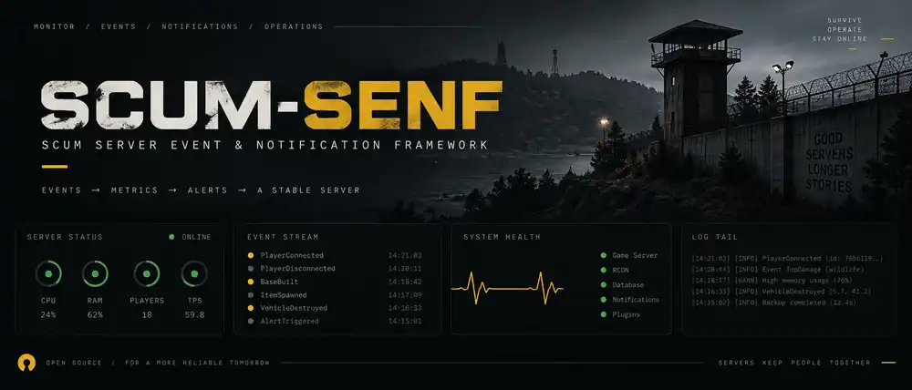

# SCUM-SENF
### SCUM Server Event & Notification Framework

**Telemetry over guessing.**

## The Mission

**A crashed server shouldn't be the first thing your players report.**

Keeping a SCUM server running takes more than restarting it when something breaks. Operators need to understand service health, important events, failures and recovery — without piecing the story together from scattered logs.

SCUM-SENF is being designed as an open-source foundation for **server observations, events and alerts**, with future integrations for notifications and operational tools.

**Know what happened. Know what changed. Know what needs attention.**

## Project status

**Research and foundation stage.** Architecture and feature scope are not final. Server integrations and notifications are goals, **not currently supported product capabilities**. No production-ready release is available.

### Follow the project

[**Issues & ideas**](https://github.com/KeilerHirsch/SCUM-SENF/issues) · [**Contributing**](CONTRIBUTING.md) · [**Security reporting**](SECURITY.md)

---

Independent community project, not affiliated with the developers or publishers of SCUM. [EUPL-1.2 licence](LICENSE) · [Voluntary support](https://ko-fi.com/keilerhirsch)
